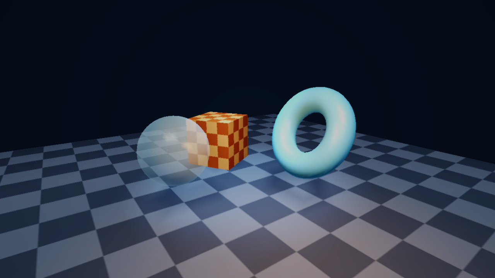

# AeroGL

A small software 3D rasterizer. No GPU, no graphics library, no shader
compiler. Just a `u32` framebuffer, a z-buffer, and triangle math. The window
part is optional and uses `minifb`, so you can turn it off and use AeroGL as a
plain library that renders into memory.

Made by AeroForger.



```rust
use aerogl::{Camera, Material, Mesh, Object, Renderer, Scene};

let mut renderer = Renderer::new(800, 800);
let mut scene = Scene::new();
scene.add(Object::new(
    Mesh::torus(32, 16, 0.9, 0.35),
    Material::new([0.30, 0.72, 1.0]).with_specular(0.7, 96.0),
));

let pixels: &[u32] = renderer.render(&scene, &Camera::default());
// give `pixels` to a window, a canvas, an encoder, whatever
```

## What you get

- A usable API: `Renderer`, `Scene`, `Object`, `Material`, `Camera`, `Mesh`,
  `Mat4`/`Vec3`. If you want the guts, `Framebuffer`/`Target` and the draw
  functions are public too.
- A normal 3D pipeline: indexed meshes, perspective camera, depth buffer,
  near and far clipping (Sutherland-Hodgman in clip space), backface culling,
  perspective-correct color/UV interpolation, and Gouraud Blinn-Phong shading.
- **Textures**: UVs on every built-in mesh, bilinear sampling, repeat/clamp/
  mirror wrapping, and procedural `Texture::checker` / `Texture::from_fn`.
- **Multiple lights**: the primary directional sun plus any number of
  `PointLight` and `SpotLight` entries, with smooth distance falloff and spot
  cones. Ambient, diffuse, specular, rim, and emissive terms.
- **Shadow mapping**: an optional directional depth pass with PCF filtering,
  adjustable resolution, bias, and darkness. The older planar mask shadows are
  still available for a cheap ground-only look.
- **Transparency**: `Material::alpha` sends an object through a depth-sorted,
  back-to-front blended pass with depth writes disabled.
- **Fog** and a **post-process** stage: exposure, Reinhard/ACES tone mapping,
  saturation, vignette, and gamma.
- **OBJ loading**: `Mesh::from_obj(&str)` and `Mesh::load_obj(path)` handle
  positions, UVs, normals, negative indices, and polygon faces.
- Two anti-aliasing modes, `Msaa { factor }` and `Smaa`, switchable at runtime.
  If a supersampled request would create a huge frame, the renderer falls back
  to SMAA automatically, so a large window cannot silently cost 4x the fill
  rate.
- Planar shadows that do not stack. Shadow geometry goes into an offscreen
  binary mask, then gets mixed in once per pixel, so overlapping triangles
  cannot make the same spot darker and darker.
- Any resolution. Nothing is locked to 800x800, and you can resize whenever.
- Uses all your cores when the frame is big enough. Pixel work is split into
  horizontal bands; small frames stay single-threaded so thread startup never
  costs more than it saves.
- Runs on anything with `std`. The core has no platform code, and the window is
  opt in.

## Install

```toml
[dependencies]
aerogl = { path = "../AeroGL" }
```

Or clone the repo and run `cargo run --release`.

## Quick start with a window

```rust
use aerogl::{AeroglWindow, Camera, Material, Mesh, Object, Scene};

fn main() {
    let mut app = AeroglWindow::new("hello, 3D", 800, 600).expect("window");
    let mut camera = Camera::new(0.6, 0.35, 8.0);
    let mut scene = Scene::new();
    scene.add(
        Object::new(Mesh::cube(), Material::new([0.95, 0.45, 0.2]))
            .with_transform(aerogl::Mat4::translation(aerogl::Vec3::new(0.0, 0.2, 0.0))),
    );

    while app.is_open() {
        app.draw(&scene, &camera).expect("present");
    }
}
```

`AeroglWindow::window_mut()` gives you the raw `minifb` window if you need
input. Nothing in the library makes you use it.

## Quick start without a window

```rust
use aerogl::{AntiAliasing, Camera, Renderer, Scene};

let mut renderer = Renderer::new(1280, 720);
renderer.options.aa = AntiAliasing::Msaa { factor: 2 };
renderer.options.background = 0x0010_1820;
// Optional: allow a bigger supersampled buffer before falling back to SMAA.
renderer.options.max_internal_pixels = Some(8_000_000);

let scene = Scene::new();
let pixels = renderer.render(&scene, &Camera::default());
// `pixels` has width * height packed 0x00RRGGBB values
```

There is a complete example that writes `aerogl.ppm` and needs no window:

```
cargo run --release --example offscreen --no-default-features
```

For the full feature set (textures, three lights, shadow map, glass, fog, ACES),
render a still to PPM:

```
cargo run --release --example pipeline -- out.ppm
```

Use this on servers, in CI screenshots, in tests, in Wasm, or behind SDL, winit,
or your own toolkit.

## API summary

| Type | What it does |
|---|---|
| `Renderer` | Holds the buffers, runs the pipeline, and returns pixels. Settings live in `options.aa`, `options.background`, `options.max_internal_pixels`, and `options.post`. `active_aa()` reports the mode actually used at the current size. |
| `Scene` | Objects, the primary `DirectionalLight`, extra `lights`, `Ground` settings (`grid`, `shadows`, `shadow_tint`), optional `fog`, and optional `shadow_map`. |
| `Object` | `mesh`, `transform`, `material`, `mode`, `casts_shadow`. Builders: `with_transform`, `with_mode`, `with_shadow`. |
| `DrawMode` | `Shaded`, `Wireframe`, `ShadedWireframe`. |
| `Mesh` | `Mesh::new(vertices, indices)` (validates), `Mesh::try_new(...)` / `Mesh::validate()` for recoverable errors, `Mesh::from_triangles(...)`, `cube()`, `sphere(stacks, slices)`, `torus(major, minor, big_r, small_r)`, `plane(size, subdivisions)`, `from_obj`, `load_obj`, `bounds`, `center`. |
| `Vertex` | Position, normal, and `uv`. `Vertex::new(pos, normal)` defaults UV to `[0,0]`; `Vertex::with_uv(...)` sets it. |
| `Material` | Base color, specular strength/exponent, rim, optional `Arc<Texture>`, `alpha`, and `emissive`. Builders: `with_texture`, `with_shared_texture`, `with_alpha`, `with_emissive`. Invalid public alpha values are clamped when used. |
| `Texture` | Packed `0x00RRGGBB` image with bilinear `sample`, `sample_nearest`, `WrapMode` (repeat/clamp/mirror), `from_fn`, `solid`, `checker`, plus `try_*` constructors that report bad sizes. |
| `Light` | `Point(PointLight)` or `Spot(SpotLight)`. Add with `Scene::add_light`. |
| `PointLight` / `SpotLight` | Position, color, intensity, range; spots add direction and inner/outer cone angles. Negative or non-finite values are repaired when used. |
| `ShadowSettings` / `ShadowMap` | Resolution, depth bias, darkness, and PCF radius. `ShadowMap` is reusable across frames. `ShadowSettings::validate()` reports values outside the accepted ranges; rendering sanitizes them. |
| `Fog` | Color plus `start`/`end` camera distances. Set `Scene::fog`. |
| `PostProcess` / `ToneMapping` | Exposure, Reinhard/ACES curve, saturation, vignette, gamma. Set `Renderer::options.post`. |
| `Camera` | Orbit camera: `yaw`, `pitch`, `distance`, `target`, `fov_y_deg`, `near`, `far`. Methods: `orbit()`, `zoom()`, `view()`, `projection(aspect)`, `eye()`, plus `validate()` for setup checks. |
| `Mat4` / `Vec3` | Math. `translation`, `rotation_x/y/z`, `scale`, `perspective`, `orthographic`, `look_at`, `transform_h`. |
| `Framebuffer` / `Target` | Raw color and depth storage, plus a borrowed render target with a `depth_write` switch. `Framebuffer::try_new` reports zero or overflowing sizes, and `is_valid()` checks public fields before borrowing. |
| `draw` | `draw_line`, `draw_line_z`, `draw_triangle_z`, `draw_triangle_gouraud`, `draw_triangle_shaded`, `draw_triangle_shadow`, `rgb`, `lerp`. |
| `ObjError` | Line-numbered OBJ parse/I/O failure with `Display` and `std::error::Error`. |

`Renderer::render` borrows the scene without changing it, so animation is just
updating `Object::transform` between frames. Meshes and materials are plain
data, so you can clone them or share them between scenes.

### Custom passes

The scene pipeline is built from public pieces. You can skip `Renderer` and
drive the rasterizer yourself if you want a mirror, a HUD, a second view, or
your own camera setup:

```rust
use aerogl::{Camera, Framebuffer, Scene, draw::rgb};

let mut fb = Framebuffer::new(640, 480);
fb.clear(0x0010_1820);

let camera = Camera::default();
let scene = Scene::new();
{
    let mut target = fb.target();
    // No planar shadow mask needed: SceneRender allocates one only when the
    // scene enables ground shadows.
    aerogl::pipeline::render_scene_with(
        &mut target,
        &scene,
        &camera,
        aerogl::pipeline::SceneRender::new().background(0x0010_1820),
    );

    // ...or draw on top with the low-level primitives:
    target.set_pixel(10, 10, rgb(1.0, 0.2, 0.2));
}

let pixels = fb.pixels();
```

For a custom camera, build the `view` and `proj` matrices yourself and call
`pipeline::render_object(&mut target, &object, view, proj, near, &ctx)`.

`draw::{draw_line, draw_line_z, draw_triangle_z, draw_triangle_gouraud}` are the
low-level primitives. `pipeline::render_object` draws one mesh with the
built-in lighting.

## Textures

Every built-in mesh carries UVs: cube faces map one full texture per side,
spheres use latitude/longitude, the torus wraps around both radii, and the
subdivided plane stretches `[0,1]` across its whole surface.

```rust
use aerogl::{Material, Mesh, Object, Texture, WrapMode};

let checker = Texture::checker(256, 8, [0.85, 0.85, 0.85], [0.08, 0.08, 0.08])
    .with_wrap(WrapMode::Repeat);

scene.add(Object::new(
    Mesh::plane(20.0, 20),
    Material::new([1.0, 1.0, 1.0]).with_texture(checker),
));
```

`Texture::from_fn(width, height, |u, v| [r, g, b])` builds anything procedural;
`Texture::new(width, height, pixels)` takes packed `0x00RRGGBB` data. Sampling is
bilinear by default with repeat, clamp, or mirror wrapping. Textures are shared
through `Arc`, so cloning a `Material` does not copy texels; use
`with_shared_texture` when several materials use the same image.

UVs and vertex colors are interpolated perspective-correctly (`attribute / w`,
then divided by the interpolated `1 / w`), so a floor texture stays stable when
it runs away from the camera.

## Lights

`Scene::light` is the primary sun. `Scene::lights` adds point and spot lights on
top of it:

```rust
use aerogl::{Light, PointLight, SpotLight, Vec3};

scene.add_light(Light::Point(
    PointLight::new(Vec3::new(3.0, 2.0, 1.0), [1.0, 0.5, 0.2])
        .with_intensity(2.5)
        .with_range(10.0),
));

scene.add_light(Light::Spot(
    SpotLight::new(Vec3::new(0.0, 6.0, 0.0), Vec3::new(0.0, -1.0, 0.0), [0.4, 0.7, 1.0])
        .with_intensity(2.5)
        .with_range(14.0)
        .with_cone(16.0, 30.0),
));
```

Point and spot lights use a smooth quadratic falloff that reaches zero at
`range` (`0` disables falloff). Spots fade smoothly between the inner and outer
cone angles. Lighting is per vertex (Gouraud), so subdivide large surfaces when
you need a local light to show up across them.

## Transparency

```rust
let glass = Material::new([0.6, 0.82, 1.0])
    .with_alpha(0.35)
    .with_specular(1.0, 128.0);
```

Materials with `alpha < 1` are held out of the opaque pass. After the opaque
objects finish, transparent objects are sorted by the distance of their
world-space bounding-box centers and drawn farthest-first with depth writes
disabled, so they blend over the scene without hiding each other. Sorting is
per object, not per triangle; interpenetrating transparent meshes can still pop.

## Fog and post-processing

```rust
use aerogl::{Fog, PostProcess, ToneMapping};

scene.fog = Some(Fog::new([0.03, 0.05, 0.09], 12.0, 34.0));

renderer.options.post = PostProcess::default()
    .with_exposure(1.2)
    .with_tone_mapping(ToneMapping::Aces)
    .with_saturation(1.08)
    .with_vignette(0.2)
    .with_gamma(1.0);
```

Fog mixes vertex colors toward the fog color between `start` and `end` camera
distances. The post pass runs after anti-aliasing and before pixels are
returned: exposure, Reinhard or ACES tone mapping, saturation, vignette, and
display gamma. The default `PostProcess` is a strict identity transform and is
skipped entirely.

## OBJ models

```rust
use aerogl::Mesh;

let mesh = Mesh::load_obj("assets/teapot.obj")?;
```

`Mesh::from_obj(&str)` parses the same format from memory. Positions, UVs,
normals, comments, negative (relative) indices, and convex polygon faces are
supported. Faces are fan-triangulated, missing UVs default to `[0,0]`, and
missing normals are generated as smooth vertex normals. Material (`mtllib` /
`usemtl`), group, and smoothing statements are ignored; assign a `Material` in
the scene instead.

## Anti-aliasing

```rust
use aerogl::AntiAliasing;

renderer.options.aa = AntiAliasing::None;                 // 1 sample per pixel
renderer.options.aa = AntiAliasing::Msaa { factor: 2 };   // 4 samples per pixel
renderer.options.aa = AntiAliasing::Smaa;                 // post-process
```

- **`Msaa`** is software supersampling. The whole frame renders at `factor`x
  resolution and then gets box-resolved. With `factor: 2` that is 4 samples per
  pixel, and the quality is about the same as 4x MSAA. Because every pass is
  supersampled, it also smooths wireframes, grid lines, and shadow edges, which
  a triangle-only MSAA would leave aliased. `factor` is clamped to 1..=4.
- **`Smaa`** is a simplified SMAA. It finds edges by luma and blends along the
  nearby pixels at native resolution. It costs about half of 4x MSAA, but it is
  a filter, so it cannot bring back detail that was never sampled. Very thin
  bright lines can lose a little contrast. It runs after the resolve.

Supersampling cost grows with the square of the factor. A 2x request at
2560x1440 would allocate a 5120x2880 frame, four times the pixels of the
window. `RenderOptions::max_internal_pixels` puts a ceiling on that: when the
requested buffer is larger, the renderer uses SMAA instead. The default is
4,000,000 pixels. `Renderer::active_aa()` tells you what actually ran.

```rust
// Force MSAA even over the budget (you are choosing the cost).
renderer.options.max_internal_pixels = None;

// Or allow a 4K supersampled buffer, still falling back above that.
renderer.options.max_internal_pixels = Some(3840 * 2160);
```

Render-only frame times for the 1,988-triangle benchmark scene in
`tests/perf.rs` (release build, 12 hardware threads; presenting the window adds
a little more). This scene predates textures, the shadow map, and post, so it
measures the base rasterizer. Measured with
`cargo test --release -- --ignored --nocapture` on this machine:

| Resolution | AA | ms/frame | fps |
|---|---|---|---|
| 800x800 | off | 0.95 | 1054 |
| 800x800 | MSAA 2x (4 samples) | 2.62 | 382 |
| 800x800 | SMAA | 1.59 | 628 |
| 1920x1080 | off | 1.43 | 701 |
| 1920x1080 | MSAA 2x requested (over budget, runs as SMAA) | 2.61 | 384 |
| 1920x1080 | SMAA | 2.73 | 367 |
| 2560x1440 | off | 2.46 | 406 |
| 2560x1440 | MSAA 2x requested (over budget, runs as SMAA) | 4.68 | 214 |
| 2560x1440 | SMAA | 4.63 | 216 |

At 1920x1080 a 2x MSAA buffer is 8,294,400 pixels, over the default 4M budget,
so the request falls back to SMAA, and the table reports that resolved cost.
Set `max_internal_pixels = None` to render the supersampled frame anyway: the
benchmark measures it at about 7.4 ms/frame at 1920x1080, a little over twice
SMAA, and it climbs fast from there.

For scale, the full 0.4 pipeline scene (`examples/pipeline.rs`: 4,836
triangles, three lights, 1536x1536 shadow map, textures, fog, and ACES)
renders 1280x720 with SMAA in about 30 ms/frame on the same machine.

## Shadows

There are two independent shadow paths.

### Planar shadows (cheap, ground only)

Objects project onto the ground plane along the light direction. Each frame
does this:

1. Draw the ground grid.
2. Render shadow triangles into an offscreen **binary mask**. There is no depth
   buffer here: the mask only records whether a pixel is covered at all.
3. Mix the mask into the frame **once** by multiplying with
   `Ground::shadow_tint`.
4. Draw the objects on top.

Step 3 runs once per pixel, so any number of overlapping shadow triangles gives
you one tint. That is the fix for the blotchy, double-darkened shadows from the
old direct-blend version. There is also an integration test that checks two
coincident casters look pixel-identical to one.

They are hard-edged, they only land on the ground plane, and only geometry above
the plane casts them. Toggle them with `scene.ground.shadows`.

### Directional shadow map

Enable real shadows on any receiving surface with one line:

```rust
use aerogl::ShadowSettings;

scene.shadow_map = Some(
    ShadowSettings::new(1024)   // depth-map resolution
        .with_bias(0.0035)      // fights shadow acne
        .with_darkness(0.65)    // 0 = black, 1 = no shadow
        .with_pcf_radius(1),    // 3x3 percentage-closer filter
);
```

The frame then builds a depth-only pass from the sun:

1. Fit an orthographic light camera to the world-space bounds of all objects.
2. Rasterize every shadow caster into a square depth map (near/far clipped).
3. While shading each vertex, project it into the light, compare depths, and
   average a `(2r+1)^2` PCF neighborhood. The result multiplies the sun's
   diffuse and specular terms.

`Renderer` owns a reusable `ShadowMap`, so a loop only clears and refills it.
The standalone `pipeline::render_scene` helpers allocate one on demand;
`render_scene_clear_with_shadow_map` accepts your own if you want control.

Things to know:

- Sampling is per vertex, because shading is Gouraud. Receivers need enough
  vertices to show a shadow edge: `Mesh::plane(size, subdivisions)` is
  subdivided for exactly this reason.
- Only the `DirectionalLight` casts a shadow map. Point and spot lights light
  the scene but do not cast shadows yet.
- Transparent objects cast if `casts_shadow` is true; they still blend normally
  when drawn.
- Turning on both planar shadows and the shadow map double-darkens the ground.
  Pick one.
- Shadow maps use a single cascade and a fixed bias. Very large scenes lose
  resolution; raise `size` or tighten the scene bounds.

## Demo

```
cargo run --release
```

A textured checker floor, a textured spinning cube, a torus, and a transparent
glass sphere, lit by the sun plus an orbiting warm point light and a sweeping
cool spot. Directional shadow mapping, distance fog, and ACES tone mapping with
a vignette are on by default. The animation is time based, so speed does not
depend on frame rate.

| Key or input | Action |
|---|---|
| **C** | cycle render mode: shaded, wireframe, then shaded + wireframe |
| **A** | cycle anti-aliasing: off, SMAA, then MSAA 2x (shown as capped when the buffer is too large) |
| **G** | toggle the ground grid overlay |
| **S** | toggle directional shadow mapping |
| **F** | toggle distance fog |
| **T** | toggle the graded post-process (ACES + vignette) |
| **Space** | pause or resume animation |
| drag | orbit camera |
| scroll | zoom |
| **Esc** | quit |

The title bar shows the mode, AA mode, triangle count, shadow/fog state, and
smoothed FPS.

## Feature flags and platforms

| Feature | Default | Effect |
|---|---|---|
| `window` | on | Pulls in `minifb` and enables `AeroglWindow`. |

- **Core library** (`--no-default-features`): no OS dependencies. Builds for
  Linux, macOS, Windows, and any target with `std`, Wasm included.
- **Window frontend** (`window`): `minifb` handles X11, Windows, and macOS. On
  Wayland-only systems it works through XWayland. If your platform is not
  covered, leave the feature off and show `Renderer::render()` pixels yourself.

```bash
cargo build --no-default-features        # headless core
cargo build                              # with the window frontend
cargo run --release
```

## Performance notes

Two bugs used to eat most of the frame time. Both are fixed:

- **Unclipped lines.** Grid lines crossing the near plane made screen
  coordinates in the millions, and the line stepper walked there one pixel at a
  time (about 1.7 s per frame). Segments are now clipped with Liang-Barsky
  against the screen rectangle, with a hard step cap as a backup.
- **Unclamped triangle bounding boxes.** One vertex near the plane could make
  the scan loop run far off screen. Boxes are clamped before looping, and near
  clipping happens in clip space instead of at some epsilon.

A couple of smaller things: the window title is rebuilt 4 times per second
instead of every frame, and the FPS cap is set once at startup.

The AA path got the same treatment:

- Without supersampling, the renderer draws straight into the output
  framebuffer now, so there is no full-frame copy.
- The 2x2 and 4x4 resolves are separate loops without per-pixel divides.
- SMAA builds a luma map, marks edge tiles, and records edge blends in compact
  per-band lists instead of copying the whole frame and writing in place.
- Shadow masks skip the depth buffer, fill scanline spans, and only clear the
  box they touched last frame.
- Triangle fills step the edge, depth and color values across each scanline
  instead of recomputing three cross products per pixel.
- Shadow tinting uses per-channel lookup tables, not a float unpack and repack
  per shadowed pixel.

Then the frame was split across cores:

- Meshes are transformed and lit once per frame, and shadow and grid geometry
  is projected once per frame. Bands only clip and rasterize the prepared data,
  so shared mesh vertices are shaded once instead of once per band.
- Objects, grid drawing and shadow compositing all run band by band in one
  thread scope. Each band owns distinct color, depth and mask rows, so there
  are no locks.
- The framebuffer clear and the MSAA downsample are also banded.
- SMAA builds its luma map, marks edge tiles, and blends in three parallel
  passes. Flat 16x16 tiles are skipped entirely.
- Bands step triangle weights from the triangle's own top, not from the band
  top, so a banded frame is pixel-for-pixel identical to a single-threaded one.
  There is a test for that, and one for each AA mode.
- Below about 200k pixels the renderer stays single-threaded; thread startup
  costs more than the work.

`AEROGL_THREADS=4 cargo run --release` caps the worker count. The default is
`available_parallelism()`, capped at 16.

On this machine (12 threads), the demo scene went from 3.9 ms to 0.9 ms at
800x800 with AA off. At 2560x1440, off is 2.7 ms, SMAA is 5.0 ms, and a 2x MSAA
request is redirected to SMAA by the default pixel budget. Before the parallel
pass and the merged clear, the same 1440p SMAA frame took about 17.8 ms.

## Project layout

```
src/
  lib.rs          crate root, module docs, re-exports
  main.rs         demo binary (window feature)
  renderer.rs     Renderer, RenderOptions, AA selection, post pass
  framebuffer.rs  Framebuffer + Target (color/depth storage, depth writes)
  pipeline/
    mod.rs        public re-exports and module docs
    shade.rs      sun, point/spot lights, shadow sampling, fog
    clip.rs       near/far clipping and screen mapping
    object.rs     vertex prep, clipping, and raster dispatch
    frame.rs      shared frame prep, banded pass, transparency
    grid.rs       ground grid projection and drawing
    shadow.rs     planar shadow mask, projection, compositing
  scene.rs        Scene, Object, DrawMode, Ground, Fog
  camera.rs       orbit camera -> view/projection matrices
  mesh.rs         indexed meshes, UVs, cube/sphere/torus/plane, OBJ helpers
  math.rs         Vec3, Mat4 (perspective + orthographic)
  material.rs     Blinn-Phong material + texture/alpha/emissive
  light.rs        DirectionalLight, PointLight, SpotLight, Light
  texture.rs      packed textures, wrapping, bilinear sampling, checker
  obj.rs          Wavefront OBJ parser and ObjError
  shadow_map.rs   directional depth pass, PCF sampling, ShadowSettings
  post.rs         exposure, tone mapping, saturation, vignette, gamma
  aa.rs           MSAA resolve + simplified SMAA
  parallel.rs     worker-count helpers and the AEROGL_THREADS override
  draw/
    pixel.rs      color packing, edge function, lerp, luma
    line.rs       clipped lines with optional depth test
    triangle/
      mod.rs      public rasterizer re-exports
      shaded.rs   perspective-correct shading, textures, alpha blending
      flat.rs     shared barycentric core, flat fill, shadow tint
      buffers.rs  mask coverage and depth-only passes
  window.rs       optional minifb frontend
  legacy/         the original learning code, kept for history, not compiled
examples/
  offscreen.rs    minimal headless render -> PPM
  pipeline.rs     full-feature headless render -> PPM
  showcase.rs     deterministic frames for the demo video
tests/
  public_api.rs   API-level integration tests
  perf.rs         ignored frame-time benchmark
```

## Testing

```
cargo test                                                 # 84 unit + 16 integration + 4 doc tests
cargo test --release -- --ignored --nocapture              # benchmarks
cargo clippy --all-targets -- -D warnings
```

Tests cover projection math (near maps to -1, far maps to +1), matrix/vector
identities, mesh winding vs. normals for all generators, near/far clipping,
z-buffer ordering, off-screen line and triangle termination,
perspective-correct texture sampling, alpha blending, point-light falloff,
fog, OBJ parsing (including negative indices and generated normals),
shadow-map projection, tone mapping, AA resolve and SMAA edge cases, banded
renders matching a single-threaded frame, and public API usage.

## Known limitations and next steps

- Lighting is per vertex (Gouraud), including shadow-map sampling. Per-pixel
  shading would need a G-buffer or an interpolated normal/material path; large
  flat surfaces need subdivision for local highlights and crisp shadows.
- Transparency is sorted per object by bounding-box center, not per triangle.
  Interpenetrating transparent meshes can pop. Depth writes are disabled for
  the transparent pass.
- Shadow maps exist only for the primary directional light. There are no
  point/spot cube maps, cascades, or per-object shadow culling yet.
- Textures are LDR packed `u32` images with bilinear filtering only. No mipmaps,
  anisotropic filtering, normal maps, or PBR.
- The tone-mapping post pass runs on the 8-bit output, not on a floating-point
  HDR framebuffer, so it cannot recover highlights that were clamped earlier.
- OBJ only. Material libraries (`mtl`) and group-level materials are ignored;
  glTF, FBX, and skeletal animation are not supported.
- No sample-level MSAA shading; `Msaa` is supersampling plus a box resolve.
- The scene is flat: `Object` has a model matrix but no parent/child hierarchy.

## License

Apache-2.0.
