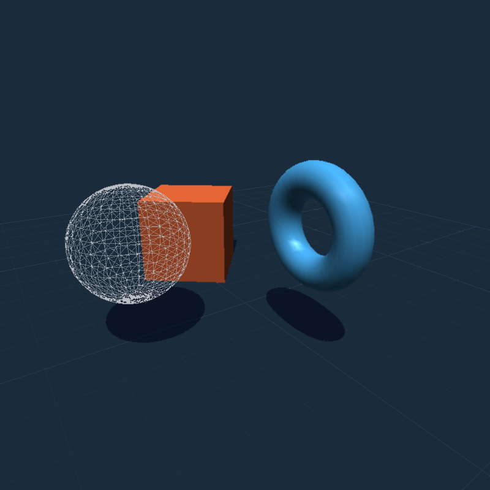

# AeroGL

A small software 3D rasterizer. No GPU, no graphics library, no shader
compiler. Just a `u32` framebuffer, a z-buffer, and triangle math. The window
part is optional and uses `minifb`, so you can turn it off and use AeroGL as a
plain library that renders into memory.

Made by AeroForger.



```rust
use aerogl::{Camera, Material, Mesh, Object, Renderer, Scene};

let mut renderer = Renderer::new(800, 800);
let mut scene = Scene::new();
scene.add(Object::new(
    Mesh::torus(32, 16, 0.9, 0.35),
    Material::new([0.30, 0.72, 1.0]).with_specular(0.7, 96.0),
));

let pixels: &[u32] = renderer.render(&scene, &Camera::default());
// give `pixels` to a window, a canvas, an encoder, whatever
```

## What you get

- A usable API: `Renderer`, `Scene`, `Object`, `Material`, `Camera`, `Mesh`,
  `Mat4`/`Vec3`. If you want the guts, `Framebuffer`/`Target` and the draw
  functions are public too.
- A normal 3D pipeline: indexed meshes, perspective camera, depth buffer,
  near-plane clipping (Sutherland-Hodgman in clip space), backface culling, and
  Gouraud Blinn-Phong shading (diffuse, specular, and a bit of rim light).
- Two anti-aliasing modes, `Msaa { factor }` and `Smaa`, and you can switch
  between them at runtime. If a supersampled request would create a huge frame,
  the renderer falls back to SMAA automatically, so a large window cannot
  silently cost 4x the fill rate.
- Planar shadows that do not stack. Shadow geometry goes into an offscreen
  binary mask, then gets mixed in once per pixel, so overlapping triangles
  cannot make the same spot darker and darker.
- Any resolution. Nothing is locked to 800x800, and you can resize whenever.
- Uses all your cores when the frame is big enough. Pixel work is split into
  horizontal bands; small frames stay single-threaded so thread startup never
  costs more than it saves.
- Runs on anything with `std`. The core has no platform code, and the window is
  opt in.

## Install

```toml
[dependencies]
aerogl = { path = "../AeroGL" }
```

Or clone the repo and run `cargo run --release`.

## Quick start with a window

```rust
use aerogl::{AeroglWindow, Camera, Material, Mesh, Object, Scene};

fn main() {
    let mut app = AeroglWindow::new("hello, 3D", 800, 600).expect("window");
    let mut camera = Camera::new(0.6, 0.35, 8.0);
    let mut scene = Scene::new();
    scene.add(
        Object::new(Mesh::cube(), Material::new([0.95, 0.45, 0.2]))
            .with_transform(aerogl::Mat4::translation(aerogl::Vec3::new(0.0, 0.2, 0.0))),
    );

    while app.is_open() {
        app.draw(&scene, &camera).expect("present");
    }
}
```

`AeroglWindow::window_mut()` gives you the raw `minifb` window if you need
input. Nothing in the library makes you use it.

## Quick start without a window

```rust
use aerogl::{AntiAliasing, Camera, Renderer, Scene};

let mut renderer = Renderer::new(1280, 720);
renderer.options.aa = AntiAliasing::Msaa { factor: 2 };
renderer.options.background = 0x0010_1820;
// Optional: allow a bigger supersampled buffer before falling back to SMAA.
renderer.options.max_internal_pixels = Some(8_000_000);

let scene = Scene::new();
let pixels = renderer.render(&scene, &Camera::default());
// `pixels` has width * height packed 0x00RRGGBB values
```

There is a complete example that writes `aerogl.ppm` and needs no window:

```
cargo run --release --example offscreen --no-default-features
```

Use this on servers, in CI screenshots, in tests, in Wasm, or behind SDL, winit,
or your own toolkit.

## API summary

| Type | What it does |
|---|---|
| `Renderer` | Holds the buffers, runs the pipeline, and returns pixels. Settings live in `options.aa`, `options.background`, and `options.max_internal_pixels`. `active_aa()` reports the mode actually used at the current size. |
| `Scene` | Objects, one `DirectionalLight`, and `Ground` settings (`grid`, `shadows`, `shadow_tint`). |
| `Object` | `mesh`, `transform`, `material`, `mode`, `casts_shadow`. Builders: `with_transform`, `with_mode`, `with_shadow`. |
| `DrawMode` | `Shaded`, `Wireframe`, `ShadedWireframe`. |
| `Mesh` | `Mesh::new(vertices, indices)`, `Mesh::from_triangles(&[(Vec3, Vec3, Vec3)])`, `cube()`, `sphere(stacks, slices)`, `torus(major, minor, big_r, small_r)`. |
| `Material` | Base color, specular strength and exponent, plus rim light. |
| `Camera` | Orbit camera: `yaw`, `pitch`, `distance`, `target`, `fov_y_deg`, `near`, `far`. Methods: `orbit()`, `zoom()`, `view()`, `projection(aspect)`. |
| `Mat4` / `Vec3` | Math. `translation`, `rotation_x/y/z`, `scale`, `perspective`, `look_at`, `transform_h`. |
| `Framebuffer` / `Target` | Raw color and depth storage, plus a borrowed render target. |
| `draw` | `draw_line`, `draw_line_z`, `draw_triangle_z`, `draw_triangle_gouraud`, `draw_triangle_shadow`, `rgb`, `lerp`. |

`Renderer::render` borrows the scene without changing it, so animation is just
updating `Object::transform` between frames. Meshes and materials are plain
data, so you can clone them or share them between scenes.

### Custom passes

The scene pipeline is built from public pieces. You can skip `Renderer` and
drive the rasterizer yourself if you want a mirror, a HUD, a second view, or
your own camera setup:

```rust
use aerogl::{Camera, Framebuffer, Scene, draw::rgb};

let mut fb = Framebuffer::new(640, 480);
fb.clear(0x0010_1820);

let camera = Camera::default();
let scene = Scene::new();
{
    let mut target = fb.target();
    let mut shadows = aerogl::pipeline::ShadowMask::new();
    aerogl::pipeline::render_scene(&mut target, &scene, &camera, &mut shadows);

    // ...or draw on top with the low-level primitives:
    target.set_pixel(10, 10, rgb(1.0, 0.2, 0.2));
}

let pixels = fb.pixels();
```

For a custom camera, build the `view` and `proj` matrices yourself and call
`pipeline::render_object(&mut target, &object, view, proj, near, &ctx)`.

`draw::{draw_line, draw_line_z, draw_triangle_z, draw_triangle_gouraud}` are the
low-level primitives. `pipeline::render_object` draws one mesh with the
built-in lighting.

## Anti-aliasing

```rust
use aerogl::AntiAliasing;

renderer.options.aa = AntiAliasing::None;                 // 1 sample per pixel
renderer.options.aa = AntiAliasing::Msaa { factor: 2 };   // 4 samples per pixel
renderer.options.aa = AntiAliasing::Smaa;                 // post-process
```

- **`Msaa`** is software supersampling. The whole frame renders at `factor`x
  resolution and then gets box-resolved. With `factor: 2` that is 4 samples per
  pixel, and the quality is about the same as 4x MSAA. Because every pass is
  supersampled, it also smooths wireframes, grid lines, and shadow edges, which
  a triangle-only MSAA would leave aliased. `factor` is clamped to 1..=4.
- **`Smaa`** is a simplified SMAA. It finds edges by luma and blends along the
  nearby pixels at native resolution. It costs about half of 4x MSAA, but it is
  a filter, so it cannot bring back detail that was never sampled. Very thin
  bright lines can lose a little contrast. It runs after the resolve.

Supersampling cost grows with the square of the factor. A 2x request at
2560x1440 would allocate a 5120x2880 frame, four times the pixels of the
window. `RenderOptions::max_internal_pixels` puts a ceiling on that: when the
requested buffer is larger, the renderer uses SMAA instead. The default is
4,000,000 pixels. `Renderer::active_aa()` tells you what actually ran.

```rust
// Force MSAA even over the budget (you are choosing the cost).
renderer.options.max_internal_pixels = None;

// Or allow a 4K supersampled buffer, still falling back above that.
renderer.options.max_internal_pixels = Some(3840 * 2160);
```

Render-only frame times on the 1,988-triangle demo scene (release build,
12 hardware threads; presenting the window adds a little more). Measured with
`cargo test --release -- --ignored --nocapture` on this machine:

| Resolution | AA | ms/frame | fps |
|---|---|---|---|
| 800x800 | off | 0.95 | 1054 |
| 800x800 | MSAA 2x (4 samples) | 2.62 | 382 |
| 800x800 | SMAA | 1.59 | 628 |
| 1920x1080 | off | 1.43 | 701 |
| 1920x1080 | MSAA 2x requested (over budget, runs as SMAA) | 2.61 | 384 |
| 1920x1080 | SMAA | 2.73 | 367 |
| 2560x1440 | off | 2.46 | 406 |
| 2560x1440 | MSAA 2x requested (over budget, runs as SMAA) | 4.68 | 214 |
| 2560x1440 | SMAA | 4.63 | 216 |

At 1920x1080 a 2x MSAA buffer is 8,294,400 pixels, over the default 4M budget,
so the request falls back to SMAA, and the table reports that resolved cost.
Set `max_internal_pixels = None` to render the supersampled frame anyway: the
showcase harness measures it at about 7.4 ms/frame at 1920x1080, a little over
twice SMAA, and it climbs fast from there.

## Shadows

Objects project onto the ground plane along the light direction. Each frame
does this:

1. Draw the ground grid.
2. Render shadow triangles into an offscreen **binary mask**. There is no depth
   buffer here: the mask only records whether a pixel is covered at all.
3. Mix the mask into the frame **once** by multiplying with
   `Ground::shadow_tint`.
4. Draw the objects on top.

Step 3 runs once per pixel, so any number of overlapping shadow triangles gives
you one tint. That is the fix for the blotchy, double-darkened shadows from the
old direct-blend version. There is also an integration test that checks two
coincident casters look pixel-identical to one.

The limits: shadows are hard-edged, they only land on the ground plane and not
on other objects, and only geometry above the plane casts them. That is the
trade for keeping this simple. Real shadow mapping is not in here yet.

## Demo

```
cargo run --release
```

A spinning shaded cube and torus, plus a wireframe sphere, over a depth-tested
ground grid with planar shadows. The animation is time based, so the speed does
not depend on frame rate.

| Key or input | Action |
|---|---|
| **C** | cycle render mode: shaded, wireframe, then shaded + wireframe |
| **A** | cycle anti-aliasing: off, SMAA, then MSAA 2x (shown as capped when the buffer is too large) |
| **G** | toggle grid |
| **S** | toggle shadows |
| **Space** | pause or resume animation |
| drag | orbit camera |
| scroll | zoom |
| **Esc** | quit |

The title bar shows the mode, AA mode, triangle count, and smoothed FPS.

## Feature flags and platforms

| Feature | Default | Effect |
|---|---|---|
| `window` | on | Pulls in `minifb` and enables `AeroglWindow`. |

- **Core library** (`--no-default-features`): no OS dependencies. Builds for
  Linux, macOS, Windows, and any target with `std`, Wasm included.
- **Window frontend** (`window`): `minifb` handles X11, Windows, and macOS. On
  Wayland-only systems it works through XWayland. If your platform is not
  covered, leave the feature off and show `Renderer::render()` pixels yourself.

```bash
cargo build --no-default-features        # headless core
cargo build                              # with the window frontend
cargo run --release
```

## Performance notes

Two bugs used to eat most of the frame time. Both are fixed:

- **Unclipped lines.** Grid lines crossing the near plane made screen
  coordinates in the millions, and the line stepper walked there one pixel at a
  time (about 1.7 s per frame). Segments are now clipped with Liang-Barsky
  against the screen rectangle, with a hard step cap as a backup.
- **Unclamped triangle bounding boxes.** One vertex near the plane could make
  the scan loop run far off screen. Boxes are clamped before looping, and near
  clipping happens in clip space instead of at some epsilon.

A couple of smaller things: the window title is rebuilt 4 times per second
instead of every frame, and the FPS cap is set once at startup.

The AA path got the same treatment:

- Without supersampling, the renderer draws straight into the output
  framebuffer now, so there is no full-frame copy.
- The 2x2 and 4x4 resolves are separate loops without per-pixel divides.
- SMAA builds a luma map, marks edge tiles, and records edge blends in compact
  per-band lists instead of copying the whole frame and writing in place.
- Shadow masks skip the depth buffer, fill scanline spans, and only clear the
  box they touched last frame.
- Triangle fills step the edge, depth and color values across each scanline
  instead of recomputing three cross products per pixel.
- Shadow tinting uses per-channel lookup tables, not a float unpack and repack
  per shadowed pixel.

Then the frame was split across cores:

- Meshes are transformed and lit once per frame, and shadow and grid geometry
  is projected once per frame. Bands only clip and rasterize the prepared data,
  so shared mesh vertices are shaded once instead of once per band.
- Objects, grid drawing and shadow compositing all run band by band in one
  thread scope. Each band owns distinct color, depth and mask rows, so there
  are no locks.
- The framebuffer clear and the MSAA downsample are also banded.
- SMAA builds its luma map, marks edge tiles, and blends in three parallel
  passes. Flat 16x16 tiles are skipped entirely.
- Bands step triangle weights from the triangle's own top, not from the band
  top, so a banded frame is pixel-for-pixel identical to a single-threaded one.
  There is a test for that, and one for each AA mode.
- Below about 200k pixels the renderer stays single-threaded; thread startup
  costs more than the work.

`AEROGL_THREADS=4 cargo run --release` caps the worker count. The default is
`available_parallelism()`, capped at 16.

On this machine (12 threads), the demo scene went from 3.9 ms to 0.9 ms at
800x800 with AA off. At 2560x1440, off is 2.7 ms, SMAA is 5.0 ms, and a 2x MSAA
request is redirected to SMAA by the default pixel budget. Before the parallel
pass and the merged clear, the same 1440p SMAA frame took about 17.8 ms.

## Project layout

```
src/
  lib.rs          crate root, module docs, re-exports
  main.rs         demo binary (window feature)
  renderer.rs     Renderer, RenderOptions, AA selection
  framebuffer.rs  Framebuffer + Target (color and depth storage)
  pipeline.rs     transforms, clipping, shading, grid, shadow mask
  scene.rs        Scene, Object, DrawMode, Ground
  camera.rs       orbit camera -> view/projection matrices
  mesh.rs         indexed meshes + cube/sphere/torus generators
  math.rs         Vec3, Mat4
  material.rs     Blinn-Phong material parameters
  light.rs        DirectionalLight
  aa.rs           MSAA resolve + simplified SMAA
  parallel.rs     worker-count helpers and the AEROGL_THREADS override
  draw/
    pixel.rs      color packing, edge function, lerp, luma
    line.rs       clipped lines with optional depth test
    triangle.rs   barycentric z-buffered fill, Gouraud, shadow tint
  window.rs       optional minifb frontend
  legacy/         the original learning code, kept for history, not compiled
examples/
  offscreen.rs    headless render -> PPM
tests/
  public_api.rs   API-level integration tests
  perf.rs         ignored frame-time benchmark
```

## Testing

```
cargo test                                                 # 52 unit + 7 integration + 4 doc tests
cargo test --release -- --ignored --nocapture              # benchmarks
cargo clippy --all-targets -- -D warnings
```

Coverage includes projection math (near maps to -1, far maps to +1),
matrix/vector identities, mesh winding vs. normals for all generators,
near-plane clipping, z-buffer ordering, off-screen line and triangle
termination, Gouraud interpolation, shadow projection and single-composite
behavior, AA resolve and SMAA edge cases, banded renders matching a
single-threaded frame, and public API usage.

## Known limitations and next steps

- Affine color interpolation across triangles, not perspective correct. Fine
  for small and medium faces, visible on large ground quads at steep angles.
- No textures, alpha blending, or sample-level MSAA shading (supersampling
  stands in).
- Hard planar shadows only.
- One directional light. No point or spot lights.
- No far-plane clipping. The projection handles depth, but geometry beyond
  `far` is not culled.

## License

Apache-2.0.
